

<a href="https://meoki.vn">
  <picture>
    <source media="(prefers-color-scheme: dark)" srcset="assets/hero-night.svg">
    
  </picture>
</a>

 

<picture>
  <source media="(prefers-color-scheme: dark)" srcset="assets/h-about-night.svg">
  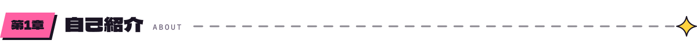
</picture>

I'm **Hoàng Đình Sáng**, known online as **Meoki**. I build quiet, useful software for the things I love: Japanese, light novels, and interfaces that feel alive.

I started as a freelance graphic designer in 2016, studied information security at university, and came out a full-stack engineer who cares about how things look as much as how they hold up. By day I ship web software. After hours I learn Japanese, read from a *tsundoku* pile that never gets shorter, and open-source the tools I wanted for my own reading.

 

<picture>
  <source media="(prefers-color-scheme: dark)" srcset="assets/h-works-night.svg">
  
</picture>

<a href="https://github.com/meokisama/moe2d"></a>

<a href="https://books.tmw.moe"></a>

<a href="https://github.com/meokisama/ranobe-blog"></a>
<a href="https://github.com/meokisama/toolkit-engine"></a>

<b>書庫</b> &nbsp;·&nbsp; <i>The back shelf</i>

 

| | | | |
|:--|:--|:--|:-:|
| [**Meoki Toolkit**](https://github.com/meokisama/meoki-toolkit) | Ten small utilities in one Chrome popup | TypeScript | 2026 |
| [**Rhythm Glow**](https://github.com/meokisama/rhythm-glow) | Sound spectrum to RGB light strips, in real time | JavaScript | 2025 |
| [**SmartThings Drivers**](https://github.com/meokisama/SmartThings) | Edge drivers for the devices at home | Lua | 2025 |
| [**UnpackKindleS**](https://github.com/meokisama/UnpackKindleS) | DRM-free azw3 to EPUB, with the HD images kept | Batch | 2025 |
| [**Reinforcement Learning**](https://github.com/meokisama/Reinforcement-Learning) | Q-learning and Sarsa for robot path planning | Python | 2023 |
| [**Django CTF**](https://github.com/meokisama/DjangoCTF) | A capture-the-flag platform with a clean face | Django | 2022 |
| [**Butterfly Effect**](https://github.com/meokisama/butterflyeffect) | A double pendulum from Lagrangian mechanics | Python | 2021 |
| [**Flappy AI**](https://github.com/meokisama/flappyAI) | NEAT neuroevolution learns to fly | Python | 2021 |
| [**VS Code Menu**](https://github.com/meokisama/vscodemenu) | Open-in-Code for the Nautilus context menu | Python | 2021 |
| [**Login Forms**](https://github.com/meokisama/login-form) | A collection of sign-in screens | HTML | 2020 |

 

<picture>
  <source media="(prefers-color-scheme: dark)" srcset="assets/h-toolbox-night.svg">
  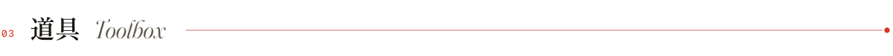
</picture>

<picture>
  <source media="(prefers-color-scheme: dark)" srcset="assets/toolbox-night.svg">
  
</picture>

 

<picture>
  <source media="(prefers-color-scheme: dark)" srcset="assets/h-path-night.svg">
  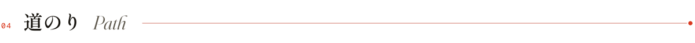
</picture>

<picture>
  <source media="(prefers-color-scheme: dark)" srcset="assets/path-night.svg">
  
</picture>

 

<picture>
  <source media="(prefers-color-scheme: dark)" srcset="assets/h-contact-night.svg">
  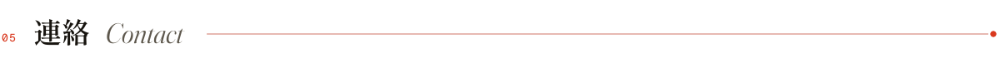
</picture>

<a href="mailto:hi@meoki.vn"></a>

  

