

<a href="https://meoki.vn">
  <picture>
    <source media="(prefers-color-scheme: dark)" srcset="assets/hero-night.svg">
    
  </picture>
</a>

 

<picture>
  <source media="(prefers-color-scheme: dark)" srcset="assets/h-about-night.svg">
  
</picture>

<picture>
  <source media="(prefers-color-scheme: dark)" srcset="assets/about-night.svg">
  
</picture>

 

<picture>
  <source media="(prefers-color-scheme: dark)" srcset="assets/h-works-night.svg">
  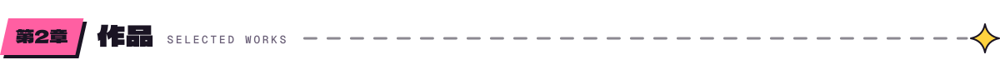
</picture>

<a href="https://github.com/meokisama/aozora"></a>

<a href="https://github.com/meokisama/gloss"></a>

<a href="https://ga.ranobe.vn"></a>
<a href="https://bxh.lightnovel.vn"></a>

<a href="https://github.com/meokisama/ranobe-hub"></a>

 

<picture>
  <source media="(prefers-color-scheme: dark)" srcset="assets/h-status-night.svg">
  
</picture>


 

<picture>
  <source media="(prefers-color-scheme: dark)" srcset="assets/h-contact-night.svg">
  
</picture>

<a href="https://twitter.com/meokiiii"></a>

<a href="https://discordapp.com/users/462097156455661568"></a>

  

<a href="mailto:hi@meoki.vn"></a>

